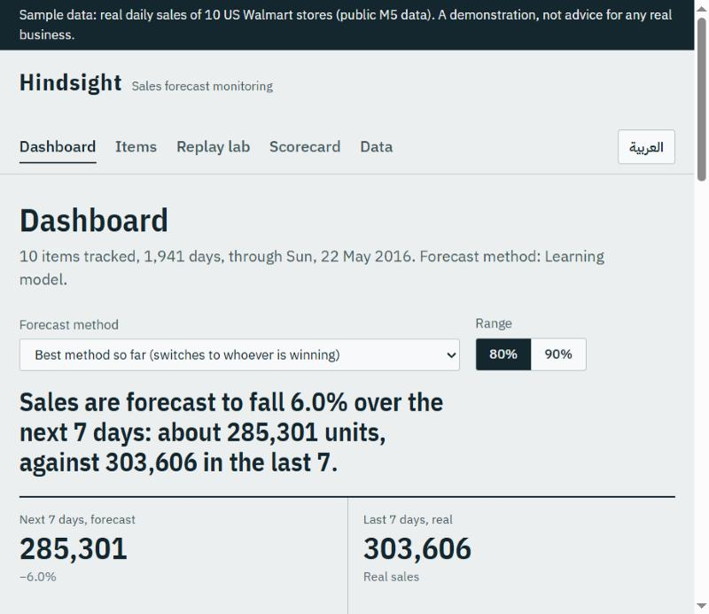
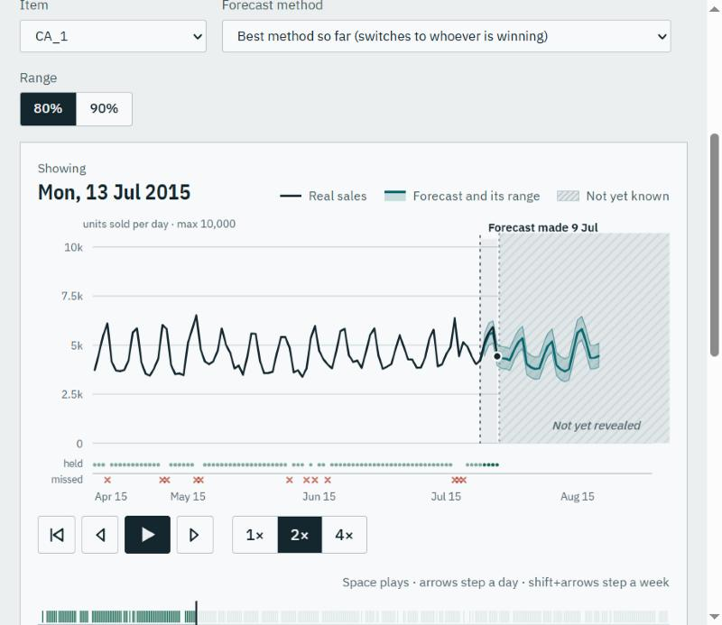
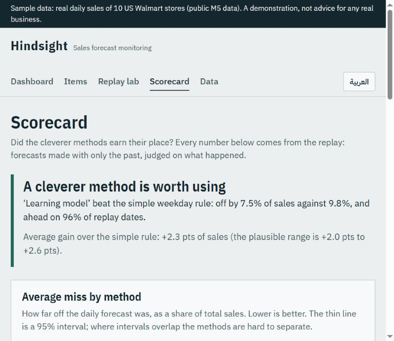

# Hindsight: a forecast you can check before you trust it

**One line:** a sales-forecast dashboard whose every forecast comes with a measured track record, built by replaying the past so that each past forecast only sees what was known at the time.



## The problem
Forecasting tools show one number and a label that says "AI". A shop owner cannot tell whether to trust it, and a good-looking chart proves nothing. Hindsight answers a narrower question honestly: *if I had used this forecast over the last two years, how often would it have been right, and would a simple rule have done as well?*

## What it does
- **Dashboard.** A one-sentence headline ("Sales are forecast to fall 6.0% over the next 7 days: about 285,301 units, against 303,606 in the last 7"), key numbers, an all-items forecast chart with its range, items to look at, and recent unusual days.
- **Items.** Every item with last week's sales, the next week's forecast, the change, and a status. An item page adds the forecast with its range, plain-language reasons (what the model leaned on, adding up to the forecast), and that item's unusual days.
- **Replay lab.** Press play and watch the past again: at each replay date the forecast sees only earlier days, its range opens ahead, and the real sales are revealed day by day behind a hatched "not yet known" area. A ribbon records every day the range held or missed.
- **Scorecard.** Whether the learning model earned its place against the simple rule ("average of the same weekday over the last four weeks"), with intervals, win rate, bias, and how often the stated range held.
- **Data.** Load your own CSV or Excel file (Arabic or English headers, Arabic digits, one row per receipt). Every guess and cleaning step is reported.
- English and right-to-left Arabic.



## How it works
1. **Rolling-origin replay.** For each past date the forecaster gets a copy of the history up to that date and nothing else. Tests change the future and check that earlier forecasts do not move.
2. **Methods.** Four simple rules, a global gradient-boosted model (one model across all items, with calendar features), and exponential smoothing in the research. The app compares simple rules against the learning model and "the best method so far", chosen only from outcomes already known.
3. **Ranges.** Rolling conformal ranges built from the same method's earlier errors that were already known at each date, scaled to the item's recent level. Coverage is measured, not assumed.
4. **Reasons.** Exact tree contributions (TreeSHAP), grouped into a few readable reasons that add up to the forecast.
5. **Odd-day alerts.** A day is flagged when real sales fall outside the 98% range of the latest forecast made before it. Catch and false-alarm rates are measured by injecting known changes.
6. **A simple rule is always in the race.** If it wins, the scorecard says so.

## Results (public M5 Walmart data, US retail)
Scored over the last 730 days (141 replay dates), 28-day forecasts, nothing tuned.

| Level | Simple rule WAPE | Learning model WAPE | Gain (95% interval) |
|---|---|---|---|
| All stores together | 7.5% | 4.5% | +3.0 pts (+2.8 to +3.2) |
| Single store | 9.8% | 7.5% | +2.3 pts (+2.0 to +2.5) |
| Store × department | 13.6% | 11.5% | +2.1 pts (+1.9 to +2.3) |

- The 80% range held on 79 to 84% of days and the 90% range on 89 to 93%, across methods and levels.
- Odd-day alerts at the 98% level caught 82% of injected one-day changes at a 2.0% false-alarm rate; closures, halvings and doublings were all caught, a +30% day only 3 times in 10.
- Exponential smoothing was *worse* than the simple rule and about ten times slower than the learning model; it is kept in the research, not in the app.



## What went wrong along the way
- **A weekday trap.** My first replay used every 7th day, so every replay date was a Sunday and one baseline looked far worse than it is. A step of 5 days fixed it and a test now guards it.
- **A real bug in a baseline** (short histories) was found by a test.
- **The importer read store names like `CA_1` as numbers.** Loading the sample exposed it; fixed with a regression test.
- **A redesign.** The first interface was upload-first, with a dark blue stage and the replay at the centre. It looked like a template and put one feature in front of a product. It was rebuilt as a dashboard with the replay as one lab among several features.

## What it does not show
- **Nothing here is evidence about Egyptian shops.** The test data is US retail. The Egyptian calendar (Ramadan, Eids, Coptic Christmas, Sham el-Nessim, national days) is built and tested, but on a labelled *synthetic* dataset with a built-in Ramadan effect, which only shows that the model can learn such an effect if it exists. On M5, Islamic events showed ratios near 1.0.
- The learning model was run with default settings, so its gain is not an upper bound, and it is not compared with deep-learning forecasters.
- Subtle changes (about 30%) are mostly invisible to a daily alert.
- The Arabic text has not been reviewed by a native speaker.
- It is daily data only, for one business at a time, with no prices or promotions.

## Run it
```bash
pip install -e ".[api,dev]"
python -m uvicorn hindsight.app.api:app --port 8100
cd web && npm install && npm run dev
```
The first run on the sample takes about a minute; later visits open at once. Data: M5 Forecasting competition data (Walmart), CC BY 4.0.
